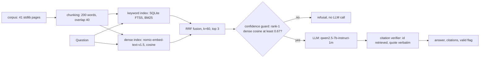
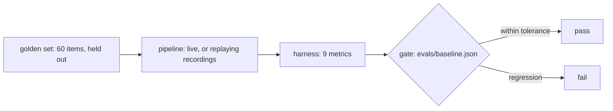

# eval-first-rag

A small retrieval-augmented question-answering system over the Python standard-library
documentation, built evaluation-first: every design change was driven by a measurement, and
every published number can be reproduced offline from committed recordings. It runs free and
locally (LM Studio on a desktop GPU), and its CI gate replays recorded model responses, so it
needs no GPU, no model and no API key.

## What this is

- **Corpus:** 41 pages of the official Python 3.12 standard-library documentation (PSF
  licence), pinned by SHA-256 ([ADR 0001](docs/adr/0001-corpus.md)).
- **Hybrid retrieval:** SQLite FTS5 (BM25) and dense cosine search over
  `nomic-embed-text-v1.5` embeddings, fused with reciprocal rank fusion; the top 3 chunks go to
  the model ([ADR 0002](docs/adr/0002-hybrid-retrieval.md)).
- **Cited answers with a quote verifier:** the model must end each sentence with
  `[chunk_id: "quote"]`. A citation is valid only if the id is one of the retrieved chunks and
  the quote occurs verbatim (after whitespace normalisation) in that chunk.
- **A retrieval-confidence abstention guard:** if the best dense cosine is below 0.67, the
  system refuses without calling the model
  ([ADR 0006](docs/adr/0006-retrieval-confidence-abstention.md)).
- **A reusable evaluation harness:** nine metrics over a frozen golden set; the harness scores
  any `question -> result` callable and imports nothing from the pipeline.
- **A CI regression gate on recorded responses:** CI replays recorded embeddings and
  completions and fails if any metric regresses past `evals/baseline.json`
  ([ADR 0004](docs/adr/0004-recorded-responses-in-ci.md)).

"Agentic" here means a small, fixed loop: retrieve, decide whether to abstain, answer, verify
the citations. It is not an open-ended agent that plans or chooses tools. There is no RAG
framework; the pipeline is about 2,500 lines of plain Python
([ADR 0003](docs/adr/0003-no-rag-framework.md)).

## Results

The golden set is held-out: 60 questions (40 single-document, 10 multi-document, 10
unanswerable), frozen before measurement and never used for tuning. Rates are over the 50
answerable items (recall, MRR, citation validity, over-refusal) or the 10 unanswerable items
(correct refusal).

| Metric | Guard on (0.67, shipped default) | Guard off |
| --- | --- | --- |
| `recall_at_k` | 0.8800 | 0.8800 |
| `mrr` | 0.8967 | 0.8967 |
| `citation_validity_rate` | 0.3000 | 0.3000 |
| `correct_refusal_rate` | 0.8000 | 0.7000 |
| `over_refusal_rate` | 0.1800 | 0.1800 |
| `latency_p50_s` | 4.373 | 4.373 |
| `latency_p95_s` | 7.113 | 7.113 |
| `prompt_tokens_total` | 76449 | 81651 |
| `completion_tokens_total` | 2970 | 3037 |

Measured 2026-10-20 with `qwen2.5-7b-instruct-1m` (Qwen2.5-7B-Instruct-1M, Q4_K_M) and
`text-embedding-nomic-embed-text-v1.5` (Q4_K_M), temperature 0, served by LM Studio on an AMD
Ryzen 9 3900X, 128 GB RAM, Radeon RX 6600 XT 8 GB; k=3, chunks of 200 words with 40 words of
overlap. One live recording (guard off), replayed with the guard on. Latency and token rows
are not comparable between the columns: an abstention makes no model call and counts as zero.
Four live runs gave identical quality metrics (spread 0 at temperature 0 on one machine).

**How to read this.** Retrieval is strong: the right document is in the top 3 for 0.88 of
answerable questions (MRR 0.90). Generation is the weak part: only 0.30 of answerable
questions (15 of 50) got a fully valid citation, which is exactly at the pre-agreed stop floor
(below 0.30 the baseline would have been blocked; one fewer valid answer would have done it).
The dev set did not predict this: the same configuration scored 0.667 on the 20-item dev set,
and that result did not transfer to the held-out golden set. Over-refusal is 0.18 (9 of 50
answerable questions refused). The guard's effect is narrow: it refused one more unanswerable
question (correct refusal 0.70 to 0.80) and changed no answerable outcome.

The story in four measurements:

1. **v0, 1B model:** `llama-3.2-1b-instruct` with the first prompt produced 0 valid citations
   of 60 and refused none of the 10 unanswerable questions, while retrieval was already fine
   (recall@5 0.90). Kept as evidence in [`evals/reports/`](evals/reports/README.md).
2. **Prompt iteration on the dev set:** five rounds with the 1B model on a separate 20-item dev
   set; all scored 0.0 valid citations, so the 1B model was judged insufficient for this
   format ([ADR 0005](docs/adr/0005-prompt-iteration.md)).
3. **7B model plus a parser fix, on dev:** `qwen2.5-7b-instruct-1m` followed the format, and a
   parser change to allow `"` inside quotes took dev citation validity to 0.667 (8 of 12).
4. **Held-out golden set: 0.30.** The dev result did not transfer. The failure breakdown is in
   [`golden-failure-analysis.md`](evals/reports/golden-failure-analysis.md): of the 35
   answerable items without a valid citation, only 3 had no expected document retrieved; 5
   quoted the source with swapped quote characters and 8 more differ from the source only in
   case, spacing or punctuation (by a loose check).

Full results, variance runs and the stop-floor rule: [`evals/reports/README.md`](evals/reports/README.md).
A retrieval ablation (keyword-only, dense-only, hybrid) is in
[`evals/reports/retrieval-ablation.md`](evals/reports/retrieval-ablation.md): on this set
hybrid is level with dense-only (recall@3 0.88 each; MRR 0.8967 against 0.9133), not better,
and keyword-only is the weakest (recall@3 0.82).

## Architecture

Answer path:



Evaluation path:



Module map (`src/evalrag/`):

| Module | Role |
| --- | --- |
| `corpus.py`, `chunking.py` | Load and hash-check the corpus; split pages into overlapping word chunks |
| `ingest.py` | Build the on-disk index: FTS5 database, dense `.npz`, chunk table |
| `retrieval/keyword.py` | SQLite FTS5 BM25 index |
| `retrieval/dense.py` | In-memory cosine index with `.npz` persistence |
| `retrieval/fusion.py`, `retrieval/hybrid.py` | Reciprocal rank fusion; the hybrid retriever and its confidence signal |
| `retrieval/embedder.py` | OpenAI-compatible embedder, with record and replay |
| `generation/llm.py` | OpenAI-compatible chat client, with record and replay keyed by request |
| `generation/answer.py` | Prompt, few-shot turns, citation parser and verifier |
| `pipeline.py` | Retrieve, abstain or answer, verify |
| `evals/` | Dataset loading, metrics, runner, report, baseline gate (independent of the pipeline) |
| `cli.py`, `api.py` | `evalrag` command line; FastAPI app |

## Quick start

Requires Python 3.12 or newer (CI uses 3.12). Run everything from the repository root.

Create and activate a virtual environment. Windows PowerShell:

```powershell
python -m venv .venv
.venv\Scripts\Activate.ps1
```

bash (Linux, macOS):

```bash
python -m venv .venv
source .venv/bin/activate
```

Install and run the tests:

```bash
pip install -r requirements.txt -r requirements-dev.txt
pip install -e . --no-deps
python -m pytest -q
```

### Reproduce the CI gate offline (no model needed)

These are the CI steps from [`.github/workflows/ci.yml`](.github/workflows/ci.yml), with the
outputs in the git-ignored `data/` directory. They replay the committed recordings, so they
need no model server, no network and no environment variables (leave `TOP_K`, `CHUNK_SIZE`,
`CHUNK_OVERLAP` and `MIN_DENSE_SCORE` unset). Each command is one line and works in bash and
PowerShell.

```bash
evalrag ingest --corpus corpus --replay-embeddings evals/recordings/embeddings.npz --data-dir data
evalrag eval --golden evals/golden/golden.jsonl --corpus corpus --data-dir data --replay-llm evals/recordings/llm.jsonl --replay-embeddings evals/recordings/embeddings.npz --report-out data/eval-report.md --metrics-out data/eval-metrics.json --model qwen2.5-7b-instruct-1m --hardware "replayed from recordings" --date 2026-10-20
evalrag gate --metrics data/eval-metrics.json --baseline evals/baseline.json
```

The first prints `ingested 41 documents, 1289 chunks, dim 768`, the second prints the nine
metrics (the guard-on column above), and the last prints
`gate passed: 9 metrics within tolerance`. `python -m evalrag` works in place of `evalrag`.

### Run it live

Start LM Studio's local server (port 1234) with `qwen2.5-7b-instruct-1m` and
`text-embedding-nomic-embed-text-v1.5` loaded, then set the variables from
[`.env.example`](.env.example). `evalrag` reads the process environment; it does not load a
`.env` file itself (Docker Compose does).

bash:

```bash
export LLM_BASE_URL=http://localhost:1234/v1 EMBED_BASE_URL=http://localhost:1234/v1
export LLM_MODEL=qwen2.5-7b-instruct-1m EMBED_MODEL=text-embedding-nomic-embed-text-v1.5
```

PowerShell:

```powershell
$env:LLM_BASE_URL = "http://localhost:1234/v1"; $env:EMBED_BASE_URL = "http://localhost:1234/v1"
$env:LLM_MODEL = "qwen2.5-7b-instruct-1m"; $env:EMBED_MODEL = "text-embedding-nomic-embed-text-v1.5"
```

Optional: `TOP_K` (default 3), `MIN_DENSE_SCORE` (default 0.67; 0 disables the guard),
`DATA_DIR` (default `data`). Then:

```bash
evalrag ingest --corpus corpus --data-dir data
evalrag ask "How does shutil.copy2 differ from shutil.copy?"
```

`ask` prints the answer, each citation, `refused: true|false` and
`citations valid: true|false`. `evalrag eval` without the `--replay-*` flags runs a question
set live; use the dev set (`evals/dev/dev.jsonl`) for any tuning and keep the golden set
held out.

### Re-recording

`evalrag refresh-recordings` re-records embeddings and completions against the live
endpoints and writes a report and metrics. It records into temporary files and replaces the
outputs only if the whole run succeeds, and it refuses to overwrite existing recordings unless
you pass `--overwrite`:

```bash
evalrag refresh-recordings --golden evals/golden/golden.jsonl --embeddings-out evals/recordings/embeddings.npz --llm-out evals/recordings/llm.jsonl --min-dense-score 0 --overwrite
```

Record with the guard off (`--min-dense-score 0`) so every question has a completion; the
guard is applied at replay time. A new recording needs a new `evals/baseline.json` with a
recorded reason (see "How the gate works").

### HTTP API

With the live variables set and an index in `DATA_DIR`:

```bash
uvicorn --factory evalrag.api:app_from_env --port 8000
curl http://localhost:8000/health
curl -X POST http://localhost:8000/ask -H "Content-Type: application/json" -d '{"question": "Who painted the Mona Lisa?"}'
```

`GET /health` returns `{"status":"ok"}`. `POST /ask` takes `{"question": "..."}` (1 to 2000
characters) and returns `answer`, `citations` (`chunk_id`, `quote`), `refused`,
`citations_valid`, `retrieved_ids` and `abstained`. In the verified Docker run, the question
above was abstained by the guard (`abstained: true`, `refused: true`, about 0.07 s, no model
call), and "How does shutil.copy2 differ from shutil.copy?" got a correct one-sentence answer
citing `shutil#006` with `citations_valid: false`, because the model rewrote the double quotes
in its quote as single quotes. The API has no authentication; keep it local.

### Docker

```bash
docker compose up --build
```

This builds the index from the recorded embeddings and serves the API on port 8000; the model
server (LM Studio on the host by default) is not part of the stack. See
[`docker/README.md`](docker/README.md). It was verified once, on one Windows machine with
Docker Desktop, and the container path is CPU-only.

## How the gate works

[`evals/baseline.json`](evals/baseline.json) holds, for each of the nine metrics, the
baseline value (the guard-on column above), a tolerance and a direction. `evalrag gate` fails
(exit 1) if any metric is worse than its baseline by more than its tolerance, or is missing
or not finite; improvements pass. Tolerances: 0.02 for `recall_at_k`, `mrr` and
`citation_validity_rate` (about one answerable item), 0.10 for the two refusal rates (one
unanswerable item), 25% of the value for latencies and 5% for token totals. They are floors,
because the observed spread across four live runs was zero.

A pass means the code still reproduces the scores of a FIXED recording: retrieval, prompt
construction (a changed prompt causes replay misses), citation parsing and verification,
abstention and the metrics. It cannot detect model drift or a change in live quality; only a
new recording can. To change the baseline, re-record (above) and write the new values with a
`reason` explaining the change. Any change to the prompt, parser, chunking, retrieval, model
or threshold requires this.

## Project layout

```text
src/evalrag/          the package (see the module map above)
tests/unit/           unit tests with fake embedders and models
tests/acceptance/     acceptance tests: datasets, offline replay, reports, CI, Docker, README
corpus/               41 pinned documentation pages, manifest.json with hashes, NOTICE.md
evals/golden/         the frozen golden set (60 items) and its review notes
evals/dev/            the 20-item dev set used for tuning
evals/recordings/     recorded embeddings and completions replayed by CI
evals/reports/        published reports, metrics and analyses
evals/analysis/       scripts that regenerate the analyses from the recordings
evals/baseline.json   the gate's baseline
docs/adr/             architecture decision records
docker/, Dockerfile, compose.yaml   container packaging
scripts/              corpus download script (run once)
tools/                repository hygiene and role-ownership checks
```

## Known limitations

In rough order of importance:

1. **Small, single-author evaluation sets.** The golden set has 60 items and the dev set 20,
   all written by one author. One answerable golden item moves a rate by 0.02, one
   unanswerable item by 0.10. Differences of a few items are not evidence.
2. **Citation validity is low and checks existence, not support.** 0.30 is at the stop floor.
   A valid citation means the quoted text exists in a retrieved chunk, not that it supports
   the answer; the dev analysis found valid quotes attached to claims from the model's own
   knowledge.
3. **The exact-quote verifier is strict.** Of the 35 answerable items without a valid
   citation, 5 failed only because the model swapped quote characters and 8 more differ only
   in case, spacing or punctuation (by a loose check that may include real misquotes); the
   verified Docker example failed the same way. A tolerant verifier is the top next step, but
   it must be validated on a NEW held-out set, because the golden failures have now been
   inspected and are no longer a clean test of such a change.
4. **The guard cannot catch on-topic near-misses.** A question about a module that is not in
   the corpus, or a feature an included page does not document, scores high on similarity: 6
   of 8 dev unanswerable items passed the guard. The 0.67 threshold rests on one dev item
   (the lowest-scoring answerable dev question).
5. **Results are tied to one recording and one model build:** the long-context `-1m` variant
   of Qwen2.5-7B-Instruct at Q4_K_M, one embedding model, one machine. Another model,
   quantisation, server build or GPU offload can move every number.
6. **Document-level retrieval scoring.** A chunk from the right page counts even if it does
   not contain the answer, so recall overstates passage-level precision.
7. **Recorded on Windows, replayed on Linux in CI:** cross-platform replay is unverified until
   the first CI run (the repository has no remote yet).
8. **A 1B model is insufficient** for this citation format (0 valid citations in every round).
9. **The Docker path is CPU-only** and was verified once, on one machine, with two questions.

## Next steps

1. A tolerant quote comparison (quote characters, case, markup) with an explicit check that
   the matched span still supports the claim, measured on a new held-out set.
2. A larger, multi-author golden set with passage-level labels.
3. A quote-support check beyond existence (for example an entailment or overlap test on the
   cited sentence).
4. Better abstention for on-topic near-misses, calibrated on the dev set.
5. The first CI run on Linux, to confirm cross-platform replay.

## Decisions

- [ADR 0001: Corpus](docs/adr/0001-corpus.md)
- [ADR 0002: Hybrid retrieval](docs/adr/0002-hybrid-retrieval.md)
- [ADR 0003: No RAG framework](docs/adr/0003-no-rag-framework.md)
- [ADR 0004: Recorded responses in CI](docs/adr/0004-recorded-responses-in-ci.md)
- [ADR 0005: Prompt iteration on the dev set](docs/adr/0005-prompt-iteration.md)
- [ADR 0006: Retrieval-confidence abstention](docs/adr/0006-retrieval-confidence-abstention.md)

## Provenance

- **Corpus:** unmodified text pages from the official Python 3.12 documentation archive
  (`python-3.12-docs-text.zip`, SHA-256 recorded in ADR 0001), under the PSF documentation
  licence; see [`corpus/NOTICE.md`](corpus/NOTICE.md). Per-file hashes are in
  `corpus/manifest.json` and checked on load.
- **Datasets:** the golden and dev sets were written for this project; see
  [`evals/golden/README.md`](evals/golden/README.md) and
  [`evals/dev/README.md`](evals/dev/README.md).
- **Recordings:** `evals/recordings/` holds the embeddings and completions from the one live
  golden run of 2026-10-20; regenerate them with `evalrag refresh-recordings` (above).
- **Models:** served locally through LM Studio. Their licences were not verified for this
  repository; check them before any reuse.
- **How it was built:** by AI coding agents working in separate roles (developer, tester,
  deployer, manager) under the repository owner's direction, with each commit's changed paths
  checked against its declared role by `tools/role_paths.py`.

## License

MIT; see [LICENSE](LICENSE). The corpus pages keep their PSF documentation licence.
